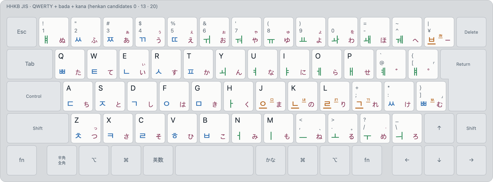
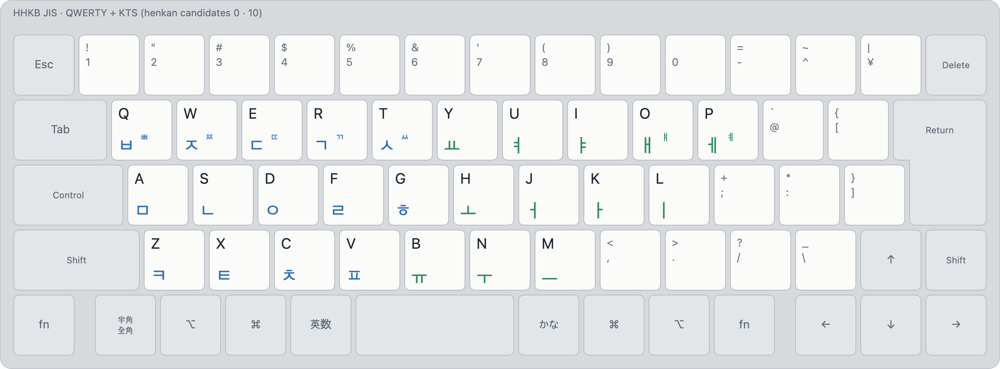

# bada ime

<picture>
  <source media="(prefers-color-scheme: dark)" srcset="docs/images/layouts/qwerty-bada-kana-dark.png">
  
</picture>

바다 입력기 · バダIME: a macOS input method for JIS keyboards with two modes. **Muhenkan** (英数)
types QWERTY. **Henkan** (かな) reads every key with all the Korean, Japanese and Latin layouts you
enable, at once, and ranks the readings as you type. There are no sub-modes to switch.

Status: **0.1.3**. 12 layouts, henkan profiles on かな, 変換 and カタカナ, kanji conversion, typo
suggestions for bada, symbol and Unicode search, and a user dictionary. Spec:
[docs/spec.md](docs/spec.md); the bada layout: [docs/bada-layout.md](docs/bada-layout.md).

**Try it in a browser:** [bada.sjun.me](https://bada.sjun.me) runs the same engine (WebAssembly)
with the same settings, on an HHKB or Apple-style JIS keyboard drawn on screen ([web/](web/README.md)).

## Install

Needs macOS 13 or later, Rust and the Command Line Tools (no Xcode).

```sh
cd mac
make            # build/BadaIME.app (universal)
make install    # into ~/Library/Input Methods, registered, with a login agent
```

Then, in System Settings → Keyboard → Input Sources:

1. Check that **Bada Muhenkan** (English) and **Bada Henkan** (Japanese) are listed.
2. Add **ABC – Extended**, then remove **ABC**, so 英数 lands in Bada Muhenkan.
3. Remove any other Japanese input methods, so かな lands in Bada Henkan.
4. From the input menu, choose **Allow 英数 and かな Everywhere…**, which grants Accessibility.
   Without it, かな can't move through the menu while you're already in henkan mode.

Or let an assistant do it: in a clone, tell a coding assistant
`Read docs/interactive-prompts/start.md and follow it.` It installs bada ime, sets up the input
sources and layouts with you, and then builds your dictionary.

## Typing

| Key | What it does |
|---|---|
| 英数 | Muhenkan mode (QWERTY). From henkan mode, it commits what shows first |
| かな | Henkan mode. Already there, with something staged: the next entry in the menu |
| Tab, ↓ / ⇧Tab, ↑, ⇧かな | Next / previous entry in the menu |
| Space, Enter, Esc, … | Commit what shows, then do what the key does (Esc commits; it doesn't cancel) |
| ⇧Enter | Commit what shows, and nothing else |
| 半角/全角, ⇧半角/全角 | Full-width / half-width: the preedit, or else the selection |
| ⌥Space | Full-width space in henkan mode; `_` in muhenkan mode |
| ⌥ + letter (muhenkan) | Its accented variants (⌥e: è é ê ë …); 1–9 pick one |
| F6–F10 | Bound in Settings to the layouts' actions (hiragana, katakana, half-width…); swallowed by default |

The menu has the readings of every enabled layout, plus kanji conversions, typo suggestions and
search results, best first. Entry 0 is what shows while you type. With **script forms** on
(Settings → Menu), ⇧Tab from entry 0 goes to hiragana (−1) and then katakana (−2). Each layout can
also be given a weight (0–10) that scales the scores of its readings.

## Henkan profiles

Profiles are off by default. When they're on (Settings → Profiles), three keys each bring up henkan
mode with **their own set of layouts**:

| Key | Profile | By default |
|---|---|---|
| かな | `mac-kana` | the henkan candidates (Settings → Layouts) |
| 変換 | `henkan` | the same as かな |
| カタカナ | `katakana` | the same as かな |

- Each profile either has **its own candidates**, or uses another profile's ("Same as …"). For
  example, かな could be QWERTY + bada, 変換 QWERTY + Japanese kana, and カタカナ Symbols + Unicode.
- **From muhenkan**, a profile key enters henkan mode in that profile. **In henkan**, another
  profile's key commits what's staged and switches profile. The current profile's own key is the
  next menu entry, as かな is.
- **かな in another profile** is a setting per profile. The default goes to the next menu entry
  when there's a menu, and otherwise back to かな's profile. The other choices: always back to
  かな's, cycle through the profiles (in an order you set), go to 変換's or カタカナ's profile, or
  leave for muhenkan.
- **F keys per profile:** each profile can have its own F6–F10 bindings, or use かな's.
- **Recording the keys:** macOS gives a PC keyboard's 変換 and カタカナ no key events of their own
  (カタカナ arrives as かな), so bada ime reads them from the keyboard's HID reports. Choose
  **Record** in Settings → Profiles and press the key; any key can be recorded this way. This needs
  Input Monitoring as well as Accessibility.

An example, an HHKB JIS with 変換 and カタカナ on Fn + かな and Fn + 英数, Korean on かな,
Japanese on 変換 and symbols on カタカナ: [docs/examples/hhkb-profiles](docs/examples/hhkb-profiles/README.md)
(settings file, keymap and a page of the whole setup).

Settings → Backup exports and imports all settings as one file (`bada-settings/1`). The web
simulator reads the same file.

## Layouts

**bada** (layout 13) types like 2-set, keeps finals like 3-set, and uses the whole key space like JIS
kana: digits and punctuation are on ⇧, so Korean never needs a prediction or a mode switch for them.
How it compares: [docs/layouts/13-bada.md](docs/layouts/13-bada.md).

The keyboard above is **QWERTY + bada + kana** (layouts 0, 13, 20): English, Korean and Japanese
from one mode. Any other set works the same way, for example standard 2-set Korean with English,
**QWERTY + KTS** (0, 10):

<picture>
  <source media="(prefers-color-scheme: dark)" srcset="docs/images/layouts/qwerty-kts-dark.png">
  
</picture>

| Id | Layout | |
|---|---|---|
| 0 | QWERTY | muhenkan, and a henkan candidate for English |
| 10 | Korean (2-set) | standard KS X 5002 on the JIS letter keys |
| 11, 12 | Korean (legacy-korean, legacy-moonshot) | the readings of JIS Korean and JIS Moonshot |
| 13 | Korean (bada) | [bada-layout.md](docs/bada-layout.md) |
| 14 | Korean (3-set JIS) | 세벌식 for JIS, 모아쓰기 |
| 18 | Korean (Roman) | Korean typed in romanisation |
| 19 | Korean (Kana) | Korean typed in kana |
| 20, 21 | Japanese (Kana, Romaji) | with kanji conversion (Mozc's dictionary) |
| 150 | Symbols | symbols and emoji by name |
| 151 | Unicode | any character by its Unicode name |

Every layout, with its rules and reliability: [docs/layouts](docs/layouts/README.md). More
combinations (bada + romaji, QWERTY + romaji): [docs/layouts/combinations.md](docs/layouts/combinations.md).

## Your dictionary

`~/Library/Application Support/bada-ime/dictionary.json` holds the words you mean (ranked up) and
the words you never mean (ranked down, or never offered), for every layout. The format is
[docs/dictionary-contract.md](docs/dictionary-contract.md). The input menu's **Open Dictionary
Folder** opens its folder. After you change the file, it's reloaded the next time bada is activated
(switch away and back).

To learn your words from your own typing, type in [utils/learner-app](utils/learner-app/README.md)
(a local page that logs a plain text field), then have an assistant merge its export into your
dictionary.

## Development

| Path | What |
|---|---|
| `engine/` | The core, in Rust: layouts, composition, ranking, the menu. `cargo test`; the typing robot: `cargo test --release --test robot` ([docs/robot.md](docs/robot.md)) |
| `mac/` | The InputMethodKit shell, in Swift: input modes, the 英数 / かな key tap, the menu, settings |
| `web/` | The simulator at bada.sjun.me: `node web/build.mjs`, `node web/test/smoke.mjs` |
| `docs/` | The spec, the bada layout and its history, one page per layout |
| `tools/` | Corpus analysis, the layout renderer and editor, a key drill, the setup page, the icon and the social preview |
| `utils/learner-app/` | Logs your typing for your dictionary: `npm start` |

All behaviour lives in the engine; the shell translates keys, switches input sources and applies
the output. A change to the Mac shell's behaviour needs the same change in `web/src`.

MIT © Mirae Research
