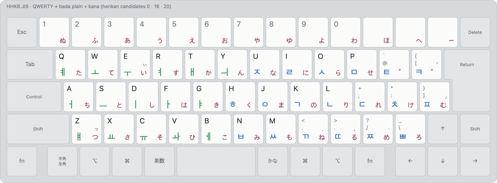
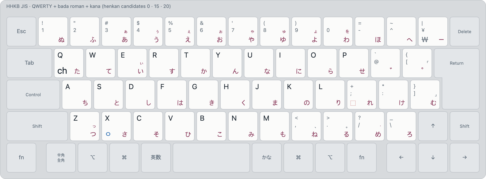

### <br>

<p align="center">
  

  <h3 align="center">
	바다 입력기 · バダIME
  </h3>

  <p align="center">
	An input method for multilinguals.
  </p>
</p>

### <br>

### Why this was built

Multilingual typing is an afterthought in most IMEs. Even JIS,
which has 4 keys dedicated to language actions, does not take
into account that the user may want to type a language other
than English or Japanese.

In bada, multilingual typing is why the IME exists at all.

There are two modes: **muhenkan** and **henkan**. This is exactly
the same as in Japanese keyboards. However, the **henkan** mode,
which is entered using **かな**, types every single candidate language
you have setup simultaneously, then ranks them and shows you candidates.

<picture>
  <source media="(prefers-color-scheme: dark)" srcset="docs/images/layouts/qwerty-bada-plain-kana-dark.png">
  
</picture>

This example demonstrates QWERTY (0), bada plain (16), and Japanese Kana (20)
all typed in **henkan** mode. Thus, `3`, `u`, `q` produce candidates
`3uq` (QWERTY), `｢졔`, `あなた` (kana) at the same time, and ranks
them. Obviously here only Japanese produces a legible phrase, so Japanese would
rank first.

<picture>
  <source media="(prefers-color-scheme: dark)" srcset="docs/images/layouts/qwerty-bada-roman-kana-dark.png">
  
</picture>

This example demonstrates QWERTY (0), bada roman (15), and Japanese Kana (20).
`g`, `w`, `i`, `h`, `a` produce candidates `gwiha` (QWERTY), `귀하` (bada roman),
`きてにくた` (kana). Obviously here Korean makes the most sense, so Korean is ranked first.

[**Try it out!**](https://bada.sjun.me/)

### bada plain

How was bada plain(16) designed? Its main consideration was that your wrists would never
have to move. All movement is done by your fingers, either moving up/down or left/right.
This reduces strain on your hands, and makes typing more comfortable.

Once you are fluent in bada typing, expect less fatigue.

### bada roman

Why does bada roman(15) exist at all? It was a fluke. I (the original developer) tried
Korean input using roman letters as an experimental joke, but it was surprisingly good.
Seriously, even if you know Korean, give it a try.

If you type primarily in English (i.e. a developer) and very rarely in Korean,
even if you are a fluent Korean speaker, this is a very good setup.

It also does not mess with your Korean 2-set (KTS) muscle memory, as you aren't memorizing
key positions. You instead memorize which roman letters map to which Korean jamo, and
keep your typing in QWERTY, separate from your existing memory of KTS.

### bada

Initial layout which started this project. It had the same goal as bada plain, but it proved
to be less than ideal during extended sessions. Thus, it was redesigned completely into
bada plain. The old layout is kept in this repository, but is no longer the default.

### How to install

Download a release, or build from source.

The releases are signed with an Apple Development certificate, but they are not notarized.
macOS will only run them without complaining on the developer's own Macs. Everywhere else,
build from source. It only takes a few minutes.

```sh
git clone https://github.com/team-mirae/bada-ime
cd bada-ime/mac
make install
```

You need Rust and the Command Line Tools (for macOS 26 or later). Xcode is not needed. The app
is universal, so Rust needs both Mac targets:
`rustup target add aarch64-apple-darwin x86_64-apple-darwin`.

Then go to System Settings → Keyboard → Input Sources:

1. Check that **bada (muhenkan)** and **bada (henkan)** are listed.
2. Add **ABC – Extended**, then remove **ABC**. Now **英数** always lands in muhenkan.
3. Remove every other Japanese input method. Now **かな** always lands in henkan.
4. From the input menu, choose **Allow 英数 and かな Everywhere…**, and allow Accessibility and
   Input Monitoring. Without them, **かな** can't move through the candidates while you are
   already in henkan, and Caps Lock stays macOS's.
5. Turn off **Use Caps Lock to switch to and from ABC**. Caps Lock is bada's now (see below).

Too lazy? Open a coding assistant in the cloned folder and tell it
`Read docs/interactive-prompts/start.md and follow it.` It will install bada, set it up,
and build your dictionary with you.

### How to type

Type in **henkan**, and the best candidate shows as you type. **Space** commits it.

If the first candidate is wrong, press **Tab**, **↓** or **かな** to move to the next one.
**⇧Tab**, **↑** and **⇧かな** go back. **⇧Enter** commits what shows, and nothing else.
**Esc** commits too. It does not cancel, unlike most IMEs.

**英数** goes back to **muhenkan**, which is plain QWERTY.

**Caps Lock** switches between the two modes. To get capitals, hold **⇧** (or **⌃**, **⌥**, **⌘**)
and press Caps Lock in muhenkan. Settings → Layouts → Caps Lock can make it a plain Caps Lock
again.

### Henkan profiles

One henkan is not always enough. If you type Japanese and Korean a lot, you may want them on
separate keys. Turn on Settings → Profiles, and **かな**, **変換** and **カタカナ** each get
their own set of layouts. For example:

| Key | Layouts |
|---|---|
| かな | QWERTY + bada roman |
| 変換 | QWERTY + Japanese Kana |
| カタカナ | Symbols + Unicode |

Japanese PC keyboards have **変換** and **カタカナ**, but macOS ignores them. bada reads them
anyway (it needs Input Monitoring for this): press **Record Key…** in Settings → Profiles, then
press the key.

The developer's own setup, an HHKB with three profiles: [docs/examples/hhkb-profiles](docs/examples/hhkb-profiles/README.md).

### Learn Korean

Don't know Korean? [learn.sjun.me](https://learn.sjun.me) teaches you to type it, by typing:
pick the layout you're aiming for (bada roman, 2-set or bada) and learn it from the first lesson.
Each track ends with the national anthem. It runs on the same engine as the IME, and its MCP
server (`https://learn.sjun.me/mcp`) teaches and quizzes you from an AI client.

### Your dictionary

bada ranks candidates by how common the words are. Your own words may not be common.
Put them in `~/Library/Application Support/bada-ime/dictionary.json`, along with the words
you never mean. The format: [docs/dictionary-contract.md](docs/dictionary-contract.md).

[utils/learner-app](utils/learner-app/README.md) logs your typing and turns it into a
dictionary.

### Layouts (ABC/가/かな)

| Id | Layout | |
|---|---|---|
| 0 | QWERTY | muhenkan, and English in henkan |
| 10 | Korean (2-set) | KTS, the standard Korean keyboard |
| 13 | Korean (bada) | [docs/layouts/13-bada.md](docs/layouts/13-bada.md) |
| 15 | Korean (bada roman) | [docs/layouts/15-bada-roman.md](docs/layouts/15-bada-roman.md) |
| 16 | Korean (bada plain) | [docs/layouts/16-bada-plain.md](docs/layouts/16-bada-plain.md) |
| 20 | Japanese (Kana) | JIS kana, with kanji conversion |
| 21 | Japanese (Romaji) | romaji, with kanji conversion |

### Layouts (other)

| Id | Layout | |
|---|---|---|
| 11 | Korean (legacy-korean) | from JIS Korean |
| 12 | Korean (legacy-moonshot) | from JIS Moonshot |
| 14 | Korean (3-set JIS) | 세벌식 for JIS, 모아쓰기 |
| 18 | Korean (Roman) | Korean in romanization |
| 19 | Korean (Kana) | Korean in kana |
| 150 | Symbols | symbols and emoji by name |
| 151 | Unicode | any character by its Unicode name |

Every layout and its rules: [docs/layouts](docs/layouts/README.md). The spec: [docs/spec.md](docs/spec.md).

### For developers

The engine is [**bada-compatible**](https://github.com/team-mirae/bada-compatible).

| Path | What |
|---|---|
| `engine/` | The core, in Rust. All behaviour lives here. `cargo test` |
| `mac/` | The macOS shell, in Swift. `make` |
| `web/` | [bada.sjun.me](https://bada.sjun.me): the engine in WebAssembly. `node web/build.mjs` |
| `docs/` | The spec, the layouts, and their history |
| `tools/`, `utils/` | Analysis, the layout renderer, the learner app |

A change to the macOS shell needs the same change in `web/src`.

### License

MIT © Mirae Research