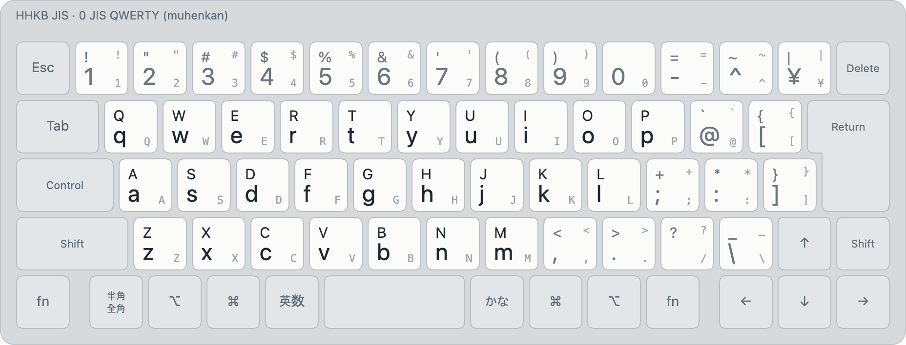

# JIS QWERTY (layout 0)

<picture>
  <source media="(prefers-color-scheme: dark)" srcset="../images/layouts/00-qwerty-dark.png">
  
</picture>

| Id | Display name | Kind |
|---|---|---|
| 0 | `QWERTY` | muhenkan |

Legends: bottom of a key unshifted, top with Shift; small grey, the JIS legend. Colours: blue initial or
consonant, orange final, green vowel, purple syllable, maroon kana.

The JIS English layout: every key types its JIS legend. It's the layout of **muhenkan mode**
(英数), where nothing composes or stages ([spec §4.2](../spec.md)). Ported from JIS Korean / JIS
Moonshot `A_QWERTY`.

- ⌥ + a letter shows its accented variants (⌥e: è é ê ë ē ė ę), picked with 1–9, 0 or the arrows;
  ⌥Space types `_` ([spec §6.2](../spec.md)).
- 半角/全角 makes the selection full-width; ⇧半角/全角 half-width.
- It can be a **henkan candidate** too: enabled in henkan mode, its plain reading (the letters as
  typed) is ranked with the other layouts' readings. That's how English words come out of henkan
  mode without switching ([combinations](combinations.md)).

Images: `python3 tools/render/export_png.py` (HHKB JIS). Interactive: open `tools/render/index.html`.
