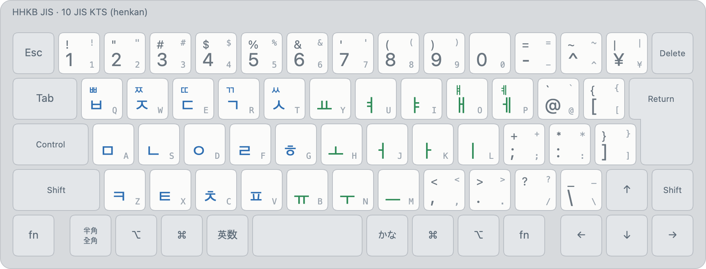

# JIS KTS (layout 10)

<picture>
  <source media="(prefers-color-scheme: dark)" srcset="../images/layouts/10-kts-dark.png">
  
</picture>

| Id | Display name | Kind |
|---|---|---|
| 10 | `Korean (2-set)` | henkan, deterministic |

Legends: bottom of a key unshifted, top with Shift; small grey, the JIS legend. Colours: blue initial or
consonant, orange final, green vowel, purple syllable, maroon kana.

The standard Korean 2-set (두벌식, KS X 5002) on the JIS letter keys. The number row and
symbol keys keep their JIS characters.

- ⇧ gives the tense consonants ㅃ ㅉ ㄸ ㄲ ㅆ (Q W E R T) and ㅒ ㅖ (O P); every other ⇧ letter
  types the same jamo.
- Composition is the usual 2-set one: consonants and vowels join into syllables, a consonant
  followed by a vowel moves to the next syllable, double finals from two keys (ㄴ ㅎ → ㄶ).
- With QWERTY (0) enabled alongside it, English and Korean come from one mode
  ([QWERTY + KTS](combinations.md#qwerty--kts)).

Images: `python3 tools/render/export_png.py` (HHKB JIS). Interactive: open `tools/render/index.html`.
