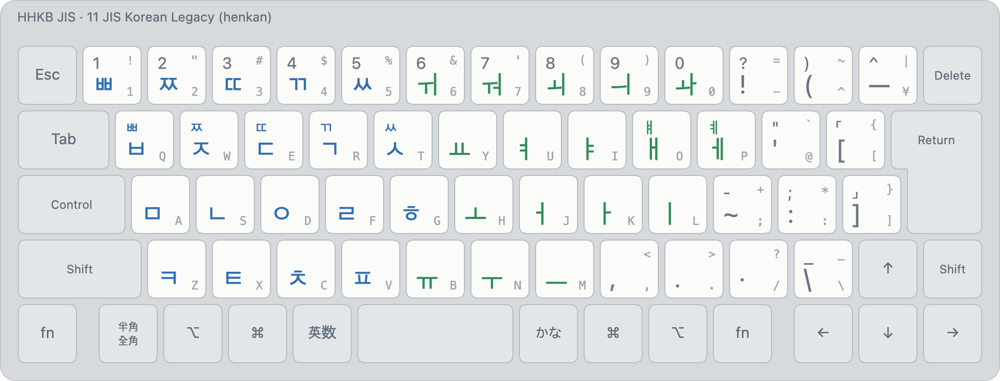

# JIS Korean Legacy (layout 11)

<!-- layout metadata -->
| | |
|---|---|
| **Name** | English: JIS Korean Legacy · 한국어: JIS 코리안 레거시 · 日本語: JIS Korean レガシー |
| **Native script** | Korean (Hangul) |
| **Short name** | English: Korean (legacy-korean) · 한국어: JIS 코리안 · 日本語: JIS Korean |
| **In-code name** | `legacy-korean` (id 11, `layout::LEGACY_KOREAN`) |
| **Reliability** | Korean: **perfect** ([typing robot](../robot.md#reliability)) |
| **Abbreviations** | JIS Korean, legacy-korean |
| **Designer** | Min Jun Sung (Mirae Research), from the JIS Korean input method (Mode A) |
| **Maintainer** | Mirae Research (미래 리서치) |
| **Contact** | mj@teammirae.com (Mirae Research); issues at https://github.com/team-mirae/bada-ime |

<picture>
  <source media="(prefers-color-scheme: dark)" srcset="../images/layouts/11-korean-legacy-dark.png">
  
</picture>

| Id | Display name | Kind |
|---|---|---|
| 11 | `Korean (legacy-korean)` | henkan, deterministic |

Legends: bottom of a key unshifted, top with Shift; small grey, the JIS legend. Colours: blue initial or
consonant, orange final, green vowel, purple syllable, maroon kana.

The Korean reading of **JIS Korean Mode A** (the predecessor in `~/Projects/jis-korean`): 2-set
on the letters, with the tense consonants and compound vowels on the number row and Korean
punctuation on the symbol keys.

- **Implied ㅇ**: a vowel with no consonant before it gets ㅇ.
- The same vowel twice keeps the final (마리 → 말이); ⇧ + vowel starts a syllable on ㅇ.
- ⇧Z is ㅋ here (it was F10 in JIS Korean).
- Not ported: predictions, hanja, the fixed F6–F10. It publishes two F-key actions, `commit` and
  `commit-bare` (the reading without the implied ㅇ), bound to nothing by default
  ([spec §7.0](../spec.md)).

Images: `python3 tools/render/export_png.py` (HHKB JIS). Interactive: open `tools/render/index.html`.
