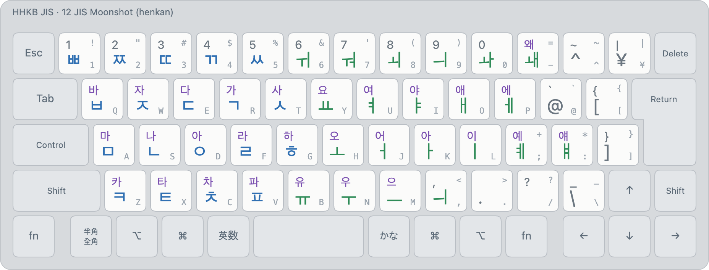

# JIS Moonshot (layout 12)

<picture>
  <source media="(prefers-color-scheme: dark)" srcset="../images/layouts/12-moonshot-dark.png">
  
</picture>

| Id | Display name | Kind |
|---|---|---|
| 12 | `Korean (legacy-moonshot)` | henkan, deterministic |

Legends: bottom of a key unshifted, top with Shift; small grey, the JIS legend. Colours: blue initial or
consonant, orange final, green vowel, purple syllable, maroon kana.

The Korean reading of **JIS Moonshot Mode A** (`~/Projects/jis-moonshot`, moonshot.md §9),
without its predictions.

- ⇧ + consonant adds ㅏ (⇧ㄱ → 가); ⇧ + vowel puts it on ㅇ (⇧ㅗ → 오).
- Tense consonants on 1–5, compound vowels on 6–0; ㅙ ㅖ ㅒ ㅢ on − ; : ,
- Enabling **0, 12, 20** together reproduces JIS Moonshot: QWERTY, Moonshot Korean and JIS kana read
  at once ([spec §4.3](../spec.md)).
- Like 11, it publishes `commit` and `commit-bare`.

Images: `python3 tools/render/export_png.py` (HHKB JIS). Interactive: open `tools/render/index.html`.
