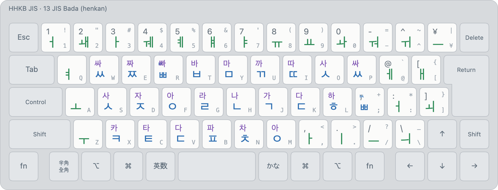

# JIS Bada (layout 13)

<!-- layout metadata -->
| | |
|---|---|
| **Name** | English: JIS Bada · 한국어: JIS 바다 레이아웃 · 日本語: JIS バダレイアウト |
| **Native script** | Korean (Hangul) |
| **Short name** | English: bada · 한국어: 바다 · 日本語: バダ |
| **In-code name** | `bada` (id 13, `layout::BADA`) |
| **Abbreviations** | bada |
| **Designer** | Min Jun Sung (Mirae Research) |
| **Maintainer** | Mirae Research (미래 리서치) |
| **Contact** | biz@sjun.me (Mirae Research); issues at https://github.com/team-mirae/bada-ime |

<picture>
  <source media="(prefers-color-scheme: dark)" srcset="../images/layouts/13-bada-dark.png">
  
</picture>

| Id | Display name | Kind |
|---|---|---|
| 13 | `Korean (bada)` | henkan, deterministic |

Legends: bottom of a key unshifted, top with Shift; small grey, the JIS legend. Colours: blue initial or
initial-or-final, orange (underlined) final only, green vowel. Q and `]` are interlaced keys: ㅃ as
an initial, ㅄ (small, orange, at the right) as a final, chosen by where the key falls in the
syllable, not by Shift.

**bada types like 2-set, keeps finals like 3-set, and uses the whole key space like JIS kana.**
Deterministic: the same keys always give the same text. Typo suggestions are listed under what was
typed, never in its place. The layout in full (keys, composing, Shift, digits and symbols, typo
suggestions, F-key actions): [bada-layout.md](../bada-layout.md).

- **Initial-or-final keys** (blue): the final of the syllable before, until a vowel takes it as its
  initial (가 E → 간, 가 E ㅏ → 가나).
- **Final-only keys** (orange: J ㅇ, K ㄴ, L ㄹ, `;` ㄱ, ¥ ㅂ; with ⇧ ㅁ ㄶ ㄺ ㄲ ㄼ): never move
  (가 K ㅏ → 간ㅏ).
- **ㅇ is typed** (F). **Every vowel has a key**; two vowel keys still join (ㅗ ㅏ → ㅘ).
- **⇧ on a number or symbol key** types its JIS character, so digits and punctuation need no mode
  switch; ⇧⌥ its shifted JIS character.

Examples: 한 V H K · 안녕 F H K E U J · 것이 D N R F M · 감사합니다 D H G R H V H B E M A H.

Bada is the default henkan layout. Its usual companions are QWERTY and kana
([QWERTY + bada + kana](combinations.md#qwerty--bada--kana)) or romaji
([bada + romaji](combinations.md#bada--romaji)).

Images: `python3 tools/render/export_png.py` (HHKB JIS). Interactive: open `tools/render/index.html`.
