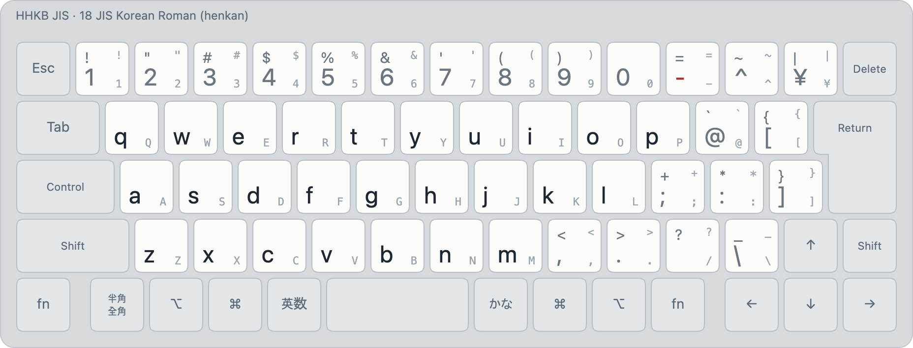

# JIS Korean Roman (layout 18)

<!-- layout metadata -->
| | |
|---|---|
| **Name** | English: Korean (Roman) · 한국어: 로마자 한국어 입력 · 日本語: ローマ字韓国語入力 |
| **Native script** | Korean (Hangul) |
| **Short name** | English: Korean (Roman) · 한국어: 로마자 한글 · 日本語: ローマ字ハングル |
| **In-code name** | `korean-roman` (id 18, `layout::KOREAN_ROMAN`) |
| **Reliability** | Korean: **production** ([typing robot](../robot.md#reliability)) |
| **Abbreviations** | Korean Roman |
| **Designer** | Spelling: the Revised Romanization of Korean (National Institute of Korean Language, 2000). The input method: Min Jun Sung (Mirae Research) |
| **Maintainer** | Mirae Research (미래 리서치) |
| **Contact** | mj@teammirae.com (Mirae Research); issues at https://github.com/team-mirae/bada-ime |

<picture>
  <source media="(prefers-color-scheme: dark)" srcset="../images/layouts/18-korean-roman-dark.png">
  
</picture>

| Id | Display name | Kind |
|---|---|---|
| 18 | `Korean (Roman)` | henkan, ranked |

Legends: bottom of a key unshifted, top with Shift; small grey, the JIS legend. Colours: blue initial or
consonant, orange final, green vowel, purple syllable, maroon kana.

Korean typed as it's romanized, with Revised Romanization and its common variants:
annyeonghaseyo → 안녕하세요, hanguk → 한국. Full rules in [korean-roman.md](../korean-roman.md).

- The **default reading** shows; other readings that spell known words are offered under it
  (k ㅋ/ㄱ, o ㅗ/ㅓ, u ㅜ/ㅡ, final t ㅅ/ㄷ/ㅆ…, m → ㅂ: gamsahamnida → 감사합니다).
- `-` or `'` splits syllables where the default wouldn't (hang-uk → 항욱).
- ⇧ + a letter is the same letter; other keys type their JIS character.

Images: `python3 tools/render/export_png.py` (HHKB JIS). Interactive: open `tools/render/index.html`.
