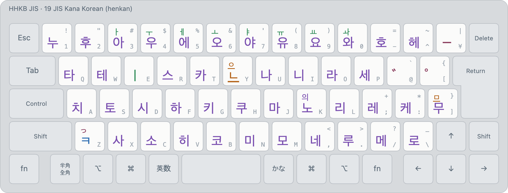

# JIS Kana Korean (layout 19)

<!-- layout metadata -->
| | |
|---|---|
| **Name** | English: Korean (Kana) · 한국어: 가나 한국어 입력 · 日本語: かな韓国語入力 |
| **Native script** | Korean (Hangul) |
| **Short name** | English: Korean (Kana) · 한국어: 가나 한글 · 日本語: かなハングル |
| **In-code name** | `kana-korean` (id 19, `layout::KANA_KOREAN`) |
| **Abbreviations** | Kana Korean |
| **Designer** | Keys: JIS kana (JIS X 6002). Kana-to-Korean readings: Min Jun Sung (Mirae Research) |
| **Maintainer** | Mirae Research (미래 리서치) |
| **Contact** | biz@sjun.me (Mirae Research); issues at https://github.com/team-mirae/bada-ime |

<picture>
  <source media="(prefers-color-scheme: dark)" srcset="../images/layouts/19-kana-korean-dark.png">
  
</picture>

| Id | Display name | Kind |
|---|---|---|
| 19 | `Korean (Kana)` | henkan, ranked |

Legends: bottom of a key unshifted, top with Shift; small grey, the JIS legend. Colours: blue initial or
consonant, orange final, green vowel, purple syllable, maroon kana.

Korean on the JIS kana layout: each kana key types its Korean approximation (た 타, し 시, ん
final ㄴ), so a kana typist types Korean without learning a second layout. Full rules in
[kana-korean.md](../kana-korean.md).

- ⇧3–⇧0 (small kana) change the previous vowel: き ⇧ゃ → 캬.
- ゛ voices the previous initial (카゛ → 가); ゜ makes ㅎ ㅍ.
- ⇧ん final ㅇ, ⇧む final ㅁ, ⇧の 의; ⇧つ (っ) makes the next initial tense.
- The table's reading shows; other pronunciations that spell known words are offered
  (はんぐく → 한국, そうる → 서울).

Images: `python3 tools/render/export_png.py` (HHKB JIS). Interactive: open `tools/render/index.html`.
