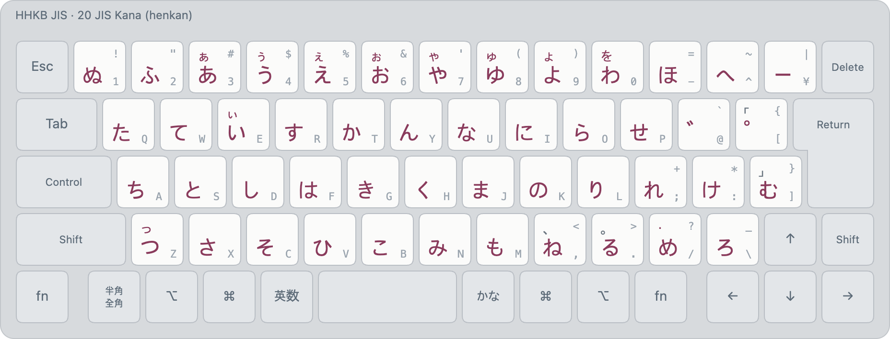

# JIS Kana (layout 20)

<!-- layout metadata -->
| | |
|---|---|
| **Name** | English: JIS Kana · 한국어: JIS 가나 자판 · 日本語: JISかな配列 |
| **Native script** | Japanese (kana) |
| **Short name** | English: Japanese (Kana) · 한국어: 가나 · 日本語: かな |
| **In-code name** | `kana` (id 20, `layout::KANA`) |
| **Abbreviations** | JIS kana |
| **Designer** | JIS X 6002 (formerly JIS C 6233). Its bada ime form (kanji conversion, menus): Min Jun Sung (Mirae Research) |
| **Maintainer** | Mirae Research (미래 리서치) |
| **Contact** | biz@sjun.me (Mirae Research); issues at https://github.com/team-mirae/bada-ime |

<picture>
  <source media="(prefers-color-scheme: dark)" srcset="../images/layouts/20-kana-dark.png">
  
</picture>

| Id | Display name | Kind |
|---|---|---|
| 20 | `Japanese (Kana)` | henkan, non-deterministic (kanji conversion) |

Legends: bottom of a key unshifted, top with Shift; small grey, the JIS legend. Colours: blue initial or
consonant, orange final, green vowel, purple syllable, maroon kana.

Japanese on the JIS kana legends (JIS Moonshot `A_KANA`), with kanji conversion from Mozc's
dictionary. Full rules in [japanese.md](../japanese.md).

- ⇧ for small kana and punctuation: ⇧3–⇧9 ぁぅぇぉゃゅょ, ⇧0 を, ⇧E ぃ, ⇧Z っ, ⇧, 、 ⇧. 。 ⇧/ ・,
  ⇧[ 「 ⇧] 」.
- ゛ (@) and ゜ ([) attach to the kana before them (か゛ → が, は゜ → ぱ).
- Typing shows the top conversion (わたしはがくせいです → 私は学生です); Tab gives the other
  conversions; with script forms on (Settings, off by default), ⇧Tab **−1 hiragana**, **−2 katakana**.
- F-key actions: `hiragana`, `katakana`, `halfwidth-katakana`, `fullwidth-latin`, `halfwidth-latin`.

Images: `python3 tools/render/export_png.py` (HHKB JIS). Interactive: open `tools/render/index.html`.
