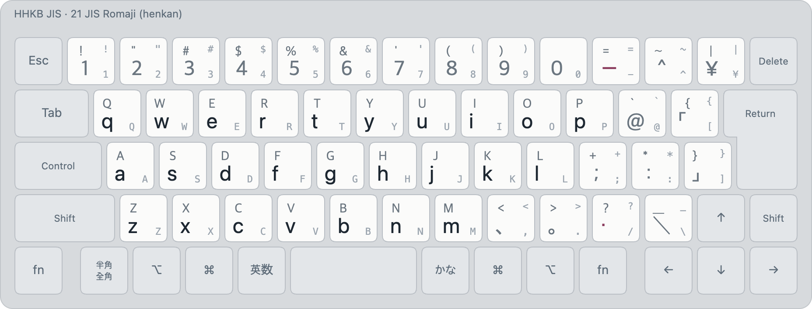

# JIS Romaji (layout 21)

<!-- layout metadata -->
| | |
|---|---|
| **Name** | English: Japanese (Romaji) · 한국어: 일본어 로마자 입력 · 日本語: ローマ字入力 |
| **Native script** | Japanese (kana) |
| **Short name** | English: Japanese (Romaji) · 한국어: 로마자 일본어 · 日本語: ローマ字 |
| **In-code name** | `romaji` (id 21, `layout::ROMAJI`) |
| **Reliability** | Japanese (romaji): **production** ([typing robot](../robot.md#reliability)) |
| **Abbreviations** | romaji |
| **Designer** | Romaji spelling as Japanese input methods use it (Hepburn and Kunrei forms). The input method: Min Jun Sung (Mirae Research) |
| **Maintainer** | Mirae Research (미래 리서치) |
| **Contact** | mj@teammirae.com (Mirae Research); issues at https://github.com/team-mirae/bada-ime |

<picture>
  <source media="(prefers-color-scheme: dark)" srcset="../images/layouts/21-romaji-dark.png">
  
</picture>

| Id | Display name | Kind |
|---|---|---|
| 21 | `Japanese (Romaji)` | henkan, non-deterministic (kanji conversion) |

Legends: bottom of a key unshifted, top with Shift; small grey, the JIS legend. Colours: blue initial or
consonant, orange final, green vowel, purple syllable, maroon kana.

Japanese typed in romaji, as Japanese IMEs spell it (ka か, shi / si し, tsu / tu つ, gakkou
がっこう, nn ん), with the same kanji conversion as Kana. Full rules in
[japanese.md](../japanese.md).

- `-` ー, `,` 、, `.` 。, `/` ・, `[` 「, `]` 」; digits and other symbols full-width.
- ⇧ + a letter is that capital, full-width.
- The same menu as Kana: conversions first, ⇧Tab for −1 hiragana and −2 katakana when script forms
  are on (off by default); the same F-key
  actions.

Images: `python3 tools/render/export_png.py` (HHKB JIS). Interactive: open `tools/render/index.html`.
