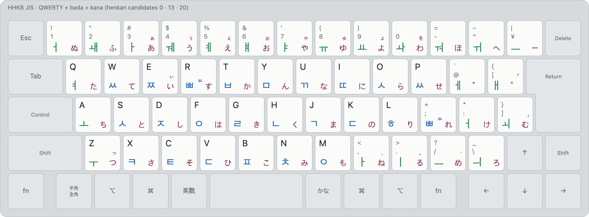
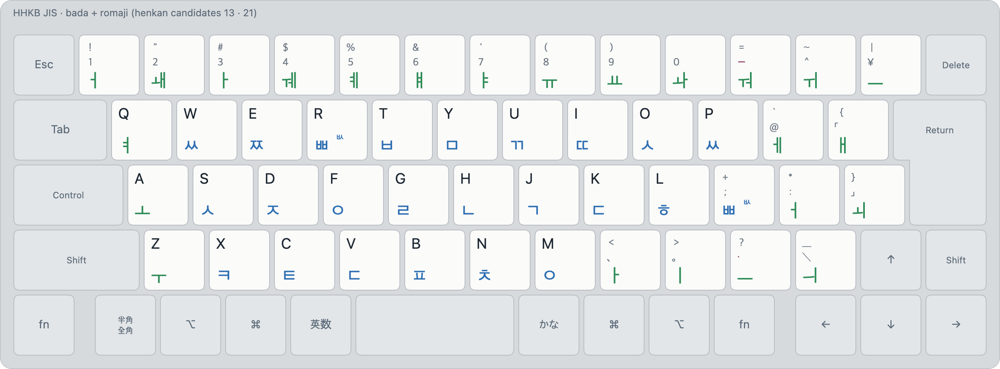
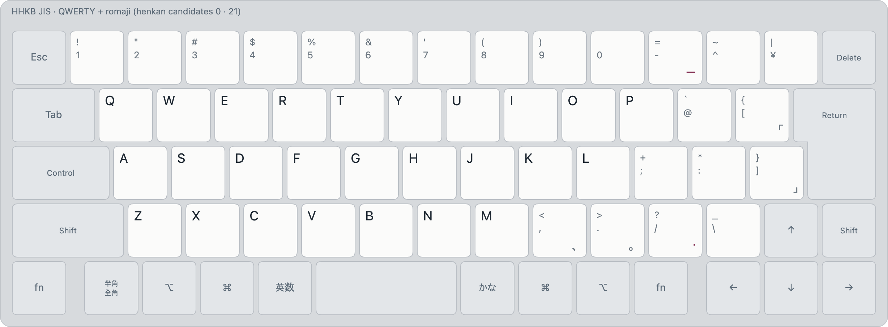
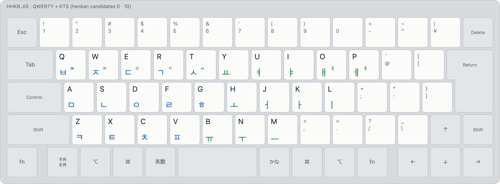

# Layout combinations

bada ime has one henkan mode, and **every enabled layout reads every keystroke at once**; the
readings are ranked as you type and the top one shows ([spec §4.3](../spec.md)). Which layouts are
enabled is a setting (Henkan candidates). So a combination isn't a new layout: it's an enabled set,
and the keyboard means all of its layouts at the same time.

These images put every enabled layout on one keycap, as a printed multi-script keycap would:

- **Top left: Latin** (QWERTY 0, Korean Roman 18, Romaji 21). Letters as capitals; on number and
  symbol keys, ⇧ above unshifted.
- **Bottom left: Korean** (KTS 10, 11, 12, Bada 13, Kana Korean 19). Large: unshifted; small at its
  right: a ⇧ legend that isn't a rule (the tense consonants of 2-set) or the rest of a token key
  (ㅃ / ㅄ). Rule-based ⇧ legends are left off: Bada's ⇧ + consonant (+ ㅏ) and ⇧ + symbol key (its
  JIS character).
- **Bottom right: kana** (Kana 20), small kana above. A second Latin layout takes this corner when
  top left is taken (QWERTY + romaji).
- A legend already on the key from an earlier layout isn't repeated (romaji's ｑ and １ are
  QWERTY's q and 1).

Render any enabled set with `tools/render/index.html` (Layout → Combinations) or
`tools/render/export_png.py`.

## QWERTY + bada + kana

<picture>
  <source media="(prefers-color-scheme: dark)" srcset="../images/layouts/qwerty-bada-kana-dark.png">
  
</picture>

Henkan candidates **0, 13, 20**. English words, Korean and Japanese from one mode, with no
switching: the ranker decides whether `QA` was `qa`, 여오 or たち. Bada's Korean needs no Shift, so ⇧
stays free for Bada's + ㅏ and kana's small kana. The same idea as JIS Moonshot (0, 12, 20), with
Bada in place of the Moonshot Korean layout.

## bada + romaji

<picture>
  <source media="(prefers-color-scheme: dark)" srcset="../images/layouts/bada-romaji-dark.png">
  
</picture>

Henkan candidates **13, 21**. Korean on Bada and Japanese in romaji, for a typist who doesn't type
kana. A romaji word that is a known Japanese word ranks first (`konnichiha` → こんにちは), and
Korean still comes out of the same keys (ㄱㅅㅎㄴㄷ → 감사합니다) ([japanese.md](../japanese.md#ranking)).

## QWERTY + romaji

<picture>
  <source media="(prefers-color-scheme: dark)" srcset="../images/layouts/qwerty-romaji-dark.png">
  
</picture>

Henkan candidates **0, 21**. Japanese and English from the same letters: the two layouts differ only
in what they make of them (kana and kanji, or the English word) and on the punctuation keys, where
romaji types ー 、 。 ・ 「 」.

## QWERTY + KTS

<picture>
  <source media="(prefers-color-scheme: dark)" srcset="../images/layouts/qwerty-kts-dark.png">
  
</picture>

Henkan candidates **0, 10**. Standard 2-set Korean and English together, ranked: the familiar
Korean layout, without a mode key between the two languages.
